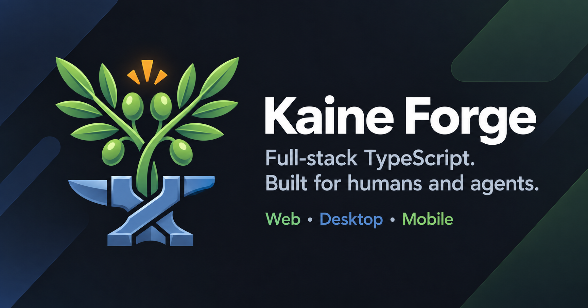

<p align="center">
  
</p>

<p align="center">
  <a href="https://github.com/ognjenmarcheta/kaine-forge/actions/workflows/ci-pr.yml"></a>
  <a href="AGENTS.md"></a>
  <a href="docs/agents/day-one.md"></a>
</p>

<p align="center">
  <a href="https://youtu.be/j-iqv4mJD_M">▶ Watch the 40-second tour</a>
</p>

# Kaine Forge

Kaine Forge is a production-oriented, **agent-ready** Turborepo template for building a full-stack TypeScript product from one repository. It includes a GraphQL API, a React web app, a Tauri desktop shell, an Expo mobile app, shared packages, release automation, and Docker build paths. Data is organization-scoped from the first commit.

People and coding agents work in the same repository under the same rules. One canonical `.ai/` source keeps five coding agents aligned, and the local agent desk takes a GitHub issue to a draft pull request.

Use it when you want a reusable starter with strong defaults instead of a blank monorepo.

## What You Get

### Apps

- `apps/api`: GraphQL Yoga API with better-auth sessions, organization-scoped data, Drizzle/Postgres, startup checks, optional production migrations, CORS/preflight handling, and cookie-first auth with bearer-token fallback.
- `apps/web`: React 19 and Vite SPA with root-aware env loading, API/GraphQL proxying, generated GraphQL hooks, design-system tokens, and an nginx Docker runtime.
- `apps/desktop`: Tauri v2 shell around the web app.
- `apps/mobile`: Expo and React Native app using shared data, auth, and translation packages and `@repo/mobile-ui`.
- `apps/e2e`: Playwright web and API tests with accessibility coverage.

### Example features

The template ships working, organization-scoped feature slices. Use them as reference code, and remove the ones your product does not need.

- **Organizations**: sign-up, sign-in, password reset, email verification, invitations, members, and an Organization switcher.
- **Todos**: Todos with Attachments in S3-compatible storage (MinIO locally) and optional AI help (OpenAI or DeepSeek).
- **Notes**: Notes that group Todos. The two-organization tenancy proof in `pnpm smoke` uses them.
- **Assistant**: an AI chat that acts on the Active Organization's data through tools, with an evaluation ledger.

### Packages and tooling

- `packages/*`: thirteen shared packages: auth, config, db, email, feature-flags, logger, mobile-ui, persistence, query, storage, todos, translation, and ui.
- `tooling/desk` and `tooling/desk-ui`: the local agent desk, the repository's software factory (see [Agent-ready](#agent-ready)).
- `tooling/graphql-codegen`: GraphQL Code Generator configuration.
- `tooling/doc-export`: exports Markdown to `.docx` or `.pptx` (`pnpm doc:export`).
- `tooling/ci-runners`: optional self-hosted GitHub Actions runners ([`docs/self-hosted-ci.md`](docs/self-hosted-ci.md)).

## Agent-ready

Agents get the same encoded rules as people. The rules are generated, linted, and checked for drift.

- **Software factory.** The local agent desk (`pnpm desk:run`) is the repository's software factory. It drives a GitHub issue through intake, plan, build, check, and review to a draft PR. The owner approves at two gates and merges. See [`docs/agents/agent-desk.md`](docs/agents/agent-desk.md).
- **One source, five agents.** [`AGENTS.md`](AGENTS.md) and `CLAUDE.md` are generated from canonical [`.ai/`](.ai/). `pnpm ai:install` targets Claude, Codex, Cursor, OpenCode, and Grok. `pnpm ai:doctor` catches skill lint errors, missing MCP requirements, and drift; CI runs it in strict mode.
- **Skills.** `kaine-*` skills cover tests, review, PRs, CI fixes, releases, issues, and triage.
- **Guardrails.** Command hooks block destructive commands, such as an unrestricted `db:push`, a merge, or a hook bypass. Commitlint rejects AI attribution in git history.
- **Tools.** Serena, Context7, and Playwright MCP servers install by default, with routing rules for when to use each.
- **Review and measurement.** [`REVIEW.md`](REVIEW.md) is one review checklist for people and agents. Harness evals measure whether a guide rule changes agent output ([`docs/agents/harness-evals.md`](docs/agents/harness-evals.md)), and `pnpm scorecard` scores repository health.
- **Learning loop.** Repeated agent failures become lint rules, tests, or skills ([ADR 0009](docs/adr/0009-domain-knowledge-as-agent-infra.md)).

New to the repository with an agent? Start with [`docs/agents/day-one.md`](docs/agents/day-one.md).

<!-- TEMPLATE_ONLY_START -->

## Is this the right template?

Kaine Forge assumes you are shipping one product across several surfaces from a single repository, with organization-scoped tenancy from the first commit and coding agents working in the repo alongside people.

It ships a GraphQL API, a React SPA, an Expo mobile app, a Tauri desktop shell, Playwright end-to-end tests, thirteen shared packages, a Docker build path per deployable app, and a generated agent scaffold.

Other templates fit other shapes better:

- [next-forge](https://github.com/vercel/next-forge) for a Next.js App Router SaaS.
- [create-t3-turbo](https://github.com/t3-oss/create-t3-turbo) for the T3 stack with Expo and a smaller surface.
- [Nx](https://nx.dev) when you want generators and a plugin platform.
- [Turborepo examples](https://github.com/vercel/turborepo/tree/main/examples) for minimal wiring to build on.

<!-- TEMPLATE_ONLY_END -->

## Prerequisites

- Node.js `>=22` (single-sourced from `.nvmrc`; CI and Docker images use Node 22)
- pnpm `10.29.3`
- Docker Desktop or a compatible Docker runtime for Postgres, MinIO, and image builds
- [uv](https://docs.astral.sh/uv/) (`curl -LsSf https://astral.sh/uv/install.sh | sh`): the default Serena MCP server starts through `uvx`
- For the agent desk: the [GitHub CLI](https://cli.github.com/) (`gh`), signed in, and the Claude Code or Codex CLI
- For desktop work: the Rust toolchain
- Recommended: [GitButler](https://docs.gitbutler.com/) desktop app and `but` CLI (`curl -fsSL https://gitbutler.com/install.sh | sh`) for parallel branches in one checkout. See [CONTRIBUTING.md](CONTRIBUTING.md#recommended-gitbutler)
- Optional: [Graphify](https://github.com/Graphify-Labs/graphify) CLI (`uv tool install "graphifyy[sql,mcp]"`) for the `pnpm graph` codebase knowledge graph
- Optional: [gitleaks](https://github.com/gitleaks/gitleaks) (`brew install gitleaks`) for the `pnpm scan:secrets` full-history secret scan

`pnpm preflight` checks the local prerequisites.

<!-- TEMPLATE_ONLY_START -->

## Template adoption

If you created a repo from this GitHub template, adopt your product identity **before** the first full setup:

```bash
pnpm install
pnpm template:adopt --write
pnpm ai:install && pnpm ai:doctor && pnpm template:adopt --check
```

Full steps (interactive dry-run, `template-adoption.json`, post-adopt checklist): [`CONTRIBUTING.md`](CONTRIBUTING.md#template-adoption).

<!-- TEMPLATE_ONLY_END -->

## Quickstart

```bash
pnpm install --frozen-lockfile
pnpm env:ensure
# Set ALLOW_LOCAL_DB_PUSH=true in .env for your local PostgreSQL database.
pnpm quick-setup
```

`quick-setup` does these steps in order:

1. Starts Postgres and MinIO with Docker Compose.
2. Runs `bootstrap`: preflight, env, install, AI assistant files, a build of every workspace except `@repo/desktop`, and `db:prepare:local` (schema push and seed).
3. Starts `pnpm dev`: the web app and the API.

Open the web app at `http://localhost:3000`. The API listens on `http://localhost:4000`. Sign in with the seed user from [`packages/db/src/seed/users.seed.ts`](packages/db/src/seed/users.seed.ts).

After the first setup:

- Start the web app and the API again: `pnpm dev`.
- Prepare the environment without starting dev servers: `pnpm bootstrap`. It assumes Postgres is reachable.
- Run the mobile app: `pnpm dev:mobile`, or `pnpm dev:mobile:lan` for a phone on the same Wi-Fi.
- Build the desktop app: `pnpm exec turbo run build --filter=@repo/desktop`. It needs the Rust toolchain, and Turbo builds `@repo/web` first.

Common failures: [`docs/troubleshooting.md`](docs/troubleshooting.md).

### Local database

Use `pnpm db:prepare:local` for local setup and `pnpm db:push:local` for local schema changes. Both need the explicit `ALLOW_LOCAL_DB_PUSH=true` opt-in and refuse a database that is not on your machine. Shared and deployed databases use reviewed migrations. See [local database rules](MONOREPO_GUIDE.md#22-local-database-and-release-commands).

### Optional: remote Turbo cache

For faster CI and local rebuilds, set the repository secret `TURBO_TOKEN` and the variable `TURBO_TEAM` (Vercel Remote Cache or compatible). See [CONTRIBUTING.md](CONTRIBUTING.md#ci-speed-maintainers).

## Build a feature

- Scaffold an organization-scoped feature slice (API and web): `pnpm create:feature <singular> --plural <plural>`. It prints a dry run first; add `--write` to create the files.
- Scaffold a shared package: `pnpm create:package <kebab-name>`.
- After a GraphQL schema or operation change, run `pnpm generate`. Do not edit generated GraphQL files by hand.
- While you iterate, run `pnpm check:affected`. Before a PR, run `pnpm check`.
- Or write a GitHub issue in the [issue format](docs/agents/issue-format.md) and give it to the agent desk.

## Deploy

Each top-level `Dockerfile.<app>` is a deployable app: `Dockerfile.api` and `Dockerfile.web`. After a merge to `main`, the Release workflow updates the `release/<app>` branch of each affected app, so only changed apps redeploy. Manual `pnpm release:apps` commands, including dry-runs, are human-only. See the Docker section of [`MONOREPO_GUIDE.md`](MONOREPO_GUIDE.md) and [`docs/release-checklist.md`](docs/release-checklist.md).

## Where to go next

| Need                                                          | Doc                                                      |
| ------------------------------------------------------------- | -------------------------------------------------------- |
| Architecture, FDD, GraphQL/data, env vars, Docker, mobile LAN | [`MONOREPO_GUIDE.md`](MONOREPO_GUIDE.md)                 |
| Design tokens, theming, web/mobile UI rules                   | [`DESIGN_SYSTEM.md`](DESIGN_SYSTEM.md)                   |
| Domain language (Organization, scope, invitations)            | [`CONTEXT.md`](CONTEXT.md)                               |
| PR workflow, checks, release, AI install                      | [`CONTRIBUTING.md`](CONTRIBUTING.md)                     |
| Production auth hardening, reporting                          | [`SECURITY.md`](SECURITY.md)                             |
| Review checklist                                              | [`REVIEW.md`](REVIEW.md)                                 |
| Agent day-one ramp                                            | [`docs/agents/day-one.md`](docs/agents/day-one.md)       |
| Agent desk (software factory) manual                          | [`docs/agents/agent-desk.md`](docs/agents/agent-desk.md) |
| Architecture decisions                                        | [`docs/adr/`](docs/adr/)                                 |
| Release validation                                            | [`docs/release-checklist.md`](docs/release-checklist.md) |
| Full documentation index                                      | [`docs/README.md`](docs/README.md)                       |

**Everyday commands:** `pnpm dev` · `pnpm preflight` · `pnpm check` · `pnpm check:affected` · `pnpm generate` · `pnpm create:feature` · `pnpm build:core` · `pnpm smoke` · `pnpm test:e2e` · `pnpm ai:install` · `pnpm ai:doctor` · `pnpm desk:run` · `pnpm scorecard` · `pnpm dev:mobile:lan`

## License

MIT — see [`LICENSE`](LICENSE).
